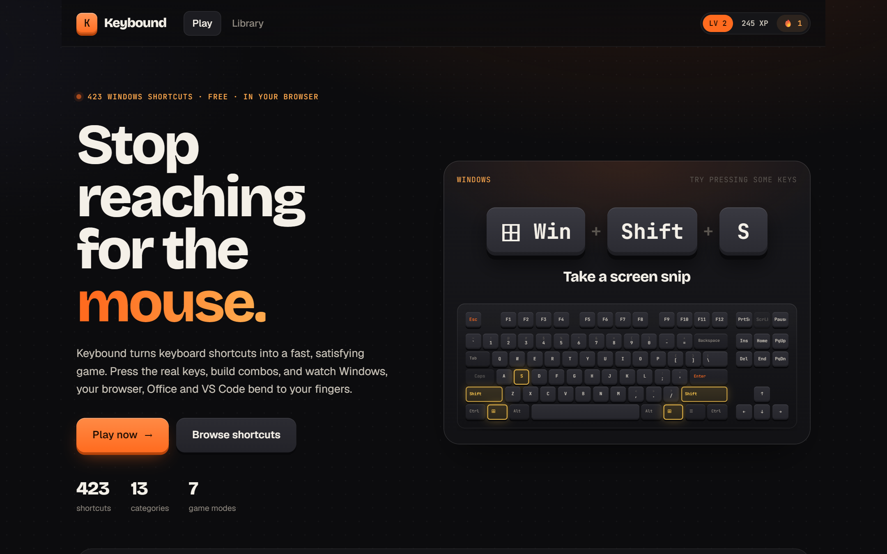
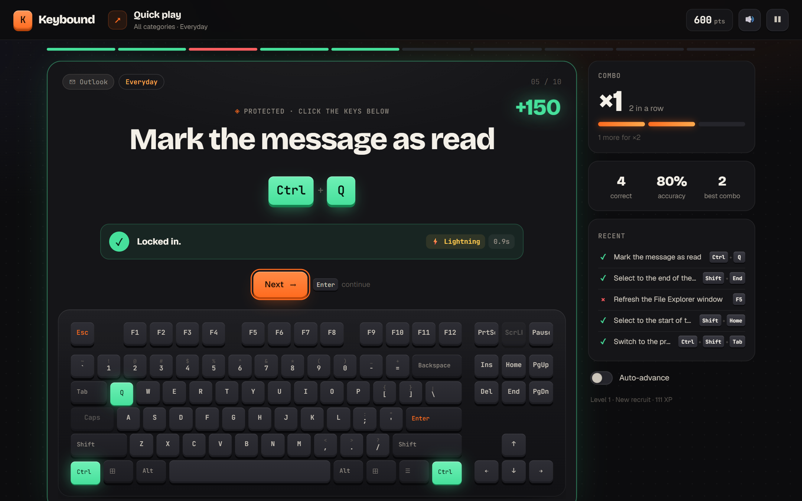
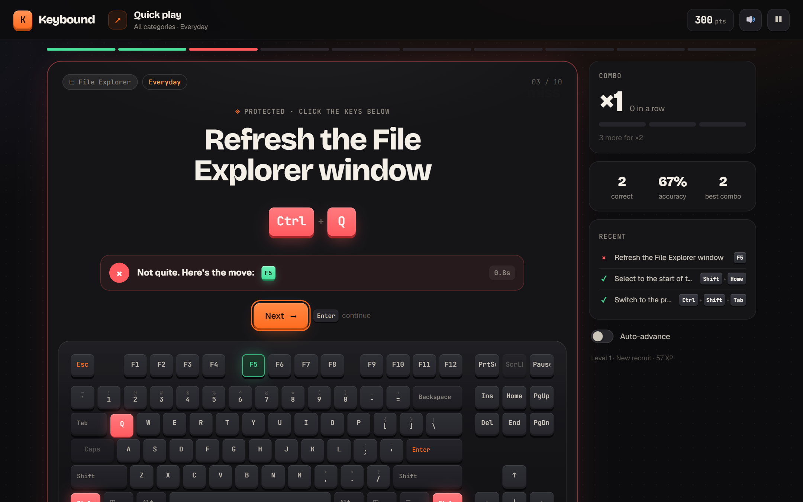
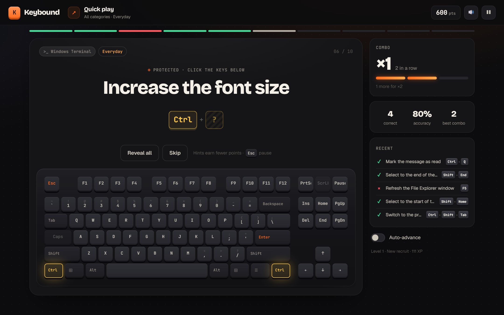
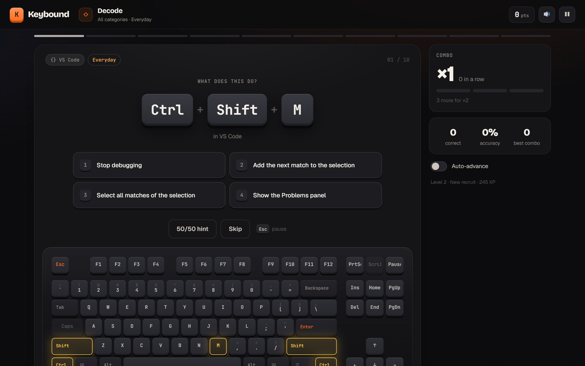
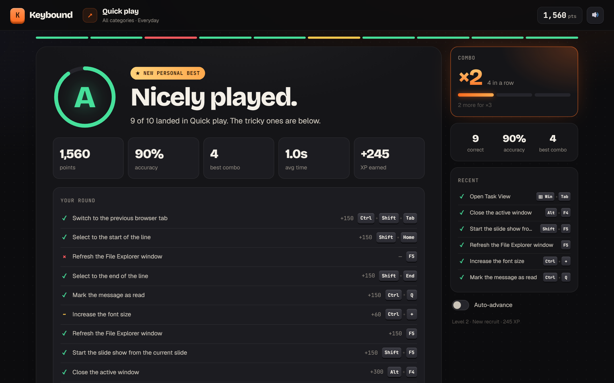
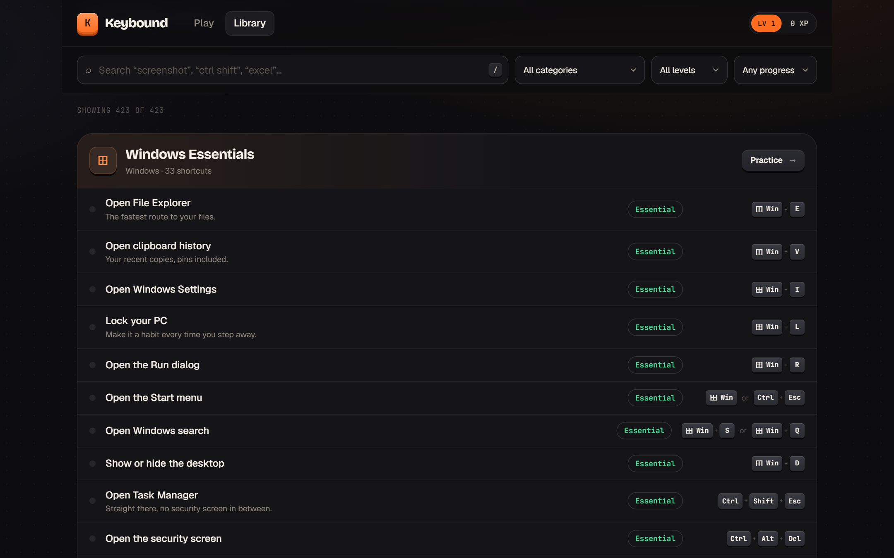

# Keybound

A browser game for learning keyboard shortcuts. Press the real keys and get feedback right away, building combos as you go, until 423 shortcuts for Windows, the browser, Office, VS Code and Windows Terminal stick.



## How it plays

You get an action, such as "Mark the message as read", and you press the shortcut for it. The on-screen keyboard lights up as you hold keys, and the answer is checked as soon as you complete a chord.

|                                                                                                                                                        |                                                                                                                              |
| ------------------------------------------------------------------------------------------------------------------------------------------------------ | ---------------------------------------------------------------------------------------------------------------------------- |
|                                                                 |              |
| **Get it right** and the keys light up green. Fast answers earn a speed bonus, and every three clean answers in a row raise your multiplier, up to ×4. | **Miss** and you see what you pressed next to the right answer. A missed shortcut comes back a few prompts later.            |
|                                                                                 |                               |
| **Hints** reveal the first key, then the whole chord. They're worth fewer points and break your combo.                                                 | **Decode** turns it around: you see the keys and pick what they do from four answers.                                        |
|                                                               |                            |
| **The round summary** grades you and lists every prompt, so you can drill the ones you missed.                                                         | **The library** lists all 423 shortcuts. Search by name, app or keys (press `/`), and filter by category, level or progress. |

### Protected shortcuts

Some shortcuts would act on your computer or browser before the page could catch them: Win + L would lock your PC and Ctrl + W would close the tab. Anything with Win or Alt, most F-keys, and browser-reserved Ctrl keys are marked **Protected**. For those, you click the keys on the on-screen keyboard and press Enter. You can build any answer this way, and the whole game is playable on a touchscreen.

## Game modes

| Mode       | What it is                                              |
| ---------- | ------------------------------------------------------- |
| Quick play | Ten prompts, no time limit.                             |
| Blitz      | Score as much as you can in 60 seconds.                 |
| Survival   | Keep going until you lose three lives.                  |
| Daily mix  | The same ten shortcuts for everyone, new each day.      |
| Decode     | See a shortcut and pick what it does from four answers. |
| Weak spots | Ten prompts, starting with the ones you've missed.      |
| Free play  | No timer and no end.                                    |

Before a round you can pick a category and a level: **Essentials** (104 shortcuts), **Everyday** (adds 174 more) or **Everything** (all 423, including 145 power-user chords).

## What's covered

| Category                                                   | Shortcuts |
| ---------------------------------------------------------- | --------: |
| Windows Essentials                                         |        33 |
| Windows & Desktops (snapping, Task View, virtual desktops) |        24 |
| Screenshots & Game Bar                                     |        12 |
| Accessibility (Magnifier, Narrator, live captions)         |        11 |
| File Explorer                                              |        22 |
| Web Browser (Chrome and Edge)                              |        43 |
| Text Editing                                               |        38 |
| Word & PowerPoint                                          |        44 |
| Excel                                                      |        49 |
| Outlook                                                    |        21 |
| VS Code                                                    |        73 |
| Browser DevTools                                           |        19 |
| Terminal & Shell (Windows Terminal, PowerShell)            |        34 |

When a shortcut has more than one chord, any of them counts. For example, Redo accepts Ctrl + Y or Ctrl + Shift + Z. Multi-step key sequences, like VS Code's Ctrl + K chords, aren't included.

## Progress

Progress is saved in your browser, so there's no account. Three correct answers in a row without hints mark a shortcut as mastered. You earn XP and levels as you play, and the game keeps your personal best for each mode, a daily streak, and 12 trophies to unlock.

## Controls

| Key       | Does                                                                   |
| --------- | ---------------------------------------------------------------------- |
| Enter     | Start a round, check a chord built on screen, or go to the next prompt |
| Esc       | Pause or resume (leaving the tab also pauses)                          |
| 1–4       | Pick an answer in Decode                                               |
| Backspace | Remove the last key from a chord built on screen                       |
| /         | Search the library                                                     |

## Getting started

```sh
pnpm install
pnpm dev
```

Open http://localhost:3000.

## Development

```sh
pnpm test        # game rules, key handling and shortcut data checks
pnpm typecheck
pnpm lint
pnpm build
```

| Path                                   | What's there                                                                  |
| -------------------------------------- | ----------------------------------------------------------------------------- |
| `data/shortcuts.ts`                    | Every shortcut, one row each: id, action, chord, level and an optional tip    |
| `lib/game.ts`                          | Modes, scoring, decks, hints, mastery, streaks and trophies                   |
| `lib/shortcut.ts`                      | Reading key presses, matching chords, and deciding which chords are protected |
| `lib/profile.ts`                       | Saved progress                                                                |
| `components/shortcut-trainer.tsx`      | The game screen                                                               |
| `components/keyboard.tsx`              | The on-screen keyboard and keycaps                                            |
| `app/page.tsx`, `app/library/page.tsx` | The home and library pages                                                    |

To add a shortcut, add a row to the right group in `data/shortcuts.ts`. Name keys as they appear on the keyboard (`Ctrl`, `Shift`, `PageDown`, `F5`, `/`) and use `Plus` and `Minus` for the = and - keys. Separate alternate chords with `|`. The tests check that every key name is valid and every id is unique.

Built with Next.js and React.
